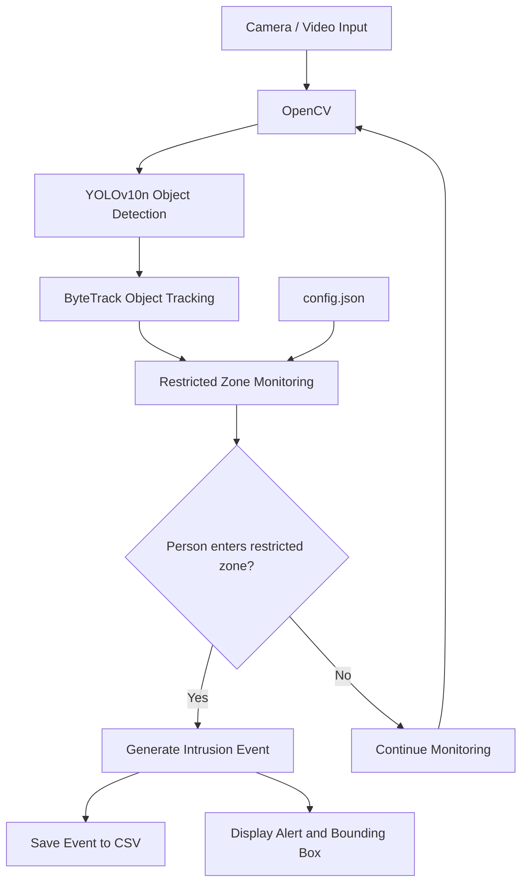

# EdgeGuard AI
## Real-Time Restricted-Area Intrusion Detection with YOLOv10n

EdgeGuard AI is a portfolio prototype that detects people entering a user-defined restricted zone. It accepts a webcam or video file and supports Ultralytics YOLO weights (`.pt`) or exported ONNX models (`.onnx`).

**Status:** prototype. FPS, latency, memory use, power consumption and accuracy must be measured on the target device. No Raspberry Pi benchmark is claimed by this repository.

### Features
- Person detection with YOLOv10n (COCO person class).
- Normalized polygon zone configuration.
- Entry-event logging to CSV.
- Optional persistent object IDs through ByteTrack.
- Bounding boxes, confidence, zone overlay and FPS estimate.
- Webcam/video input and ONNX export workflow.

### Architecture
```text
Camera/video -> OpenCV -> YOLOv10n -> person detections/tracking
                                      |
                                      v
                           foot-point / polygon test
                              |             |
                         visual alert    CSV event log
```

### Setup
Python 3.10 or 3.11 recommended.
```bash
git clone https://github.com/YOUR_USERNAME/edgeguard-ai.git
cd edgeguard-ai
python -m venv .venv
# Linux/macOS:
source .venv/bin/activate
# Windows PowerShell:
# .venv\Scripts\Activate.ps1
pip install -r requirements.txt
```
Place a compatible `yolov10n.pt` model file in the project root. Model weights are not included; check the model license before redistribution.

### Run
Webcam:
```bash
python -m edgeguard.detector --model yolov10n.pt --source 0
```
Video:
```bash
python -m edgeguard.detector --model yolov10n.pt --source path/to/video.mp4
```
Headless:
```bash
python -m edgeguard.detector --model yolov10n.pt --source 0 --no-display
```

### Configure the zone
Edit `edgeguard/config.json`. Polygon coordinates are normalized to `[0,1]` relative to frame width and height:
```json
{
  "zone_name": "RESTRICTED AREA",
  "confidence_threshold": 0.35,
  "person_class_id": 0,
  "event_cooldown_seconds": 3.0,
  "restricted_zone": [[0.55,0.20],[0.95,0.20],[0.95,0.95],[0.55,0.95]]
}
```
The prototype tests the bottom-centre point of each person bounding box against the polygon. This approximates the person's ground-contact point; perspective, occlusion and box quality can affect results.

### ONNX export
```bash
python scripts/export_onnx.py --weights yolov10n.pt --imgsz 640
python -m edgeguard.detector --model yolov10n.onnx --source 0
```
ONNX Runtime must be installed separately if it is not already available through the inference environment. Check ARM64 compatibility for Raspberry Pi OS and your Python version.

### Raspberry Pi 4 notes
- Use a 64-bit OS and a Python version supported by the selected inference packages.
- Verify ARM64 package availability before installation.
- Compare input sizes such as 320 and 416 during benchmarking.
- Measure FPS, end-to-end latency, CPU/RAM use and temperature on the actual Pi.
- Do not report desktop results as Raspberry Pi performance.

### Tests
```bash
pytest -q
```
The tests cover polygon geometry only, not detector accuracy or hardware performance.

### Limitations / future work
- Single-zone configuration in this initial version.
- Bounding-box foot point is a heuristic, not segmentation-based zone overlap.
- Tracking IDs may change after occlusion or scene changes.
- Add a labeled test set and report precision, recall and mAP before making accuracy claims.
- Possible extensions: multiple zones, event snapshots, MQTT notifications, power profiling and `.pt` vs `.onnx` benchmarking.

### Responsible use
Deploy only where monitoring is lawful and appropriately disclosed. Minimize video retention. This system detects people and zone entry; it does not identify individuals.



### Author
**Sagheb Kohpayeh Araghi**  
Computer Vision · Edge AI · Embedded Systems · YOLO · Python · OpenCV · ONNX  
GitHub: https://github.com/SaghebK
